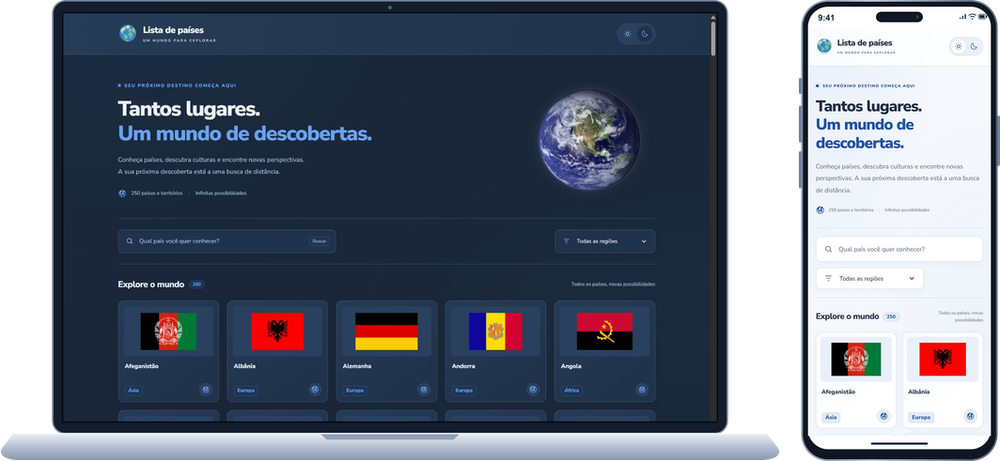

# 🌍 Lista de Países

Explore países e territórios com informações em português, pesquisa com sugestões e temas claro e escuro.

## 📸 Visão do projeto

## ✨ Recursos

- **Pesquisa inteligente:** sugestões com bandeiras e busca sem diferenciar acentos ou maiúsculas.
- **Exploração:** lista alfabética, filtro por região e contador de resultados.
- **Detalhes:** capital, população, idiomas, região e países vizinhos.
- **Temas:** preferência inicial do sistema e escolha salva no navegador.
- **Interface:** layout responsivo, cards compactos e animações suaves.
- **Acessibilidade:** navegação por teclado, foco visível e respeito ao movimento reduzido.

## 🧰 Tecnologias

| Tecnologia                            | Utilização                                                              |
| ------------------------------------- | ----------------------------------------------------------------------- |
| **Next.js 16 e React 19**             | Páginas, componentes, renderização no servidor e carregamento de dados. |
| **TypeScript 5**                      | Tipagem dos dados e componentes.                                        |
| **Tailwind CSS 4 e CSS**              | Estilos, temas, responsividade e animações.                             |
| **Node.js 24, npm, PostCSS e ESLint** | Execução, dependências, processamento de estilos e análise do código.   |

O projeto utiliza Fetch API, cache com revalidação, `Intl` para localização e `localStorage` para salvar o tema. Os ícones são arquivos SVG locais, e a imagem da Terra utiliza WebP.

## 🔌 Dados e créditos

- [**countries.dev**](https://countries.dev/docs): dados dos países.
- [**FlagCDN**](https://flagcdn.com/): bandeiras em SVG.
- [**Nunito Sans**](https://fonts.google.com/specimen/Nunito+Sans): tipografia integrada por `next/font`.
- [**NASA — Blue Marble**](https://science.nasa.gov/earth/earth-observatory/the-blue-marble-true-color-global-imagery-at-1km-resolution/): imagem da Terra, de Reto Stöckli, com composição e cores de Robert Simmon / NASA Goddard Space Flight Center.

Baseado no mini-projeto [Lista de Países — Codante](https://codante.io/mini-projetos/lista-de-paises-nextjs). Código sob a [licença MIT](LICENSE).

## 🚀 Acesse o projeto

[💻 Link para o GitHub](https://github.com/netoMendes21/Lista-de-Paises)

[🌍 Site Lista de Países](https://mp-lista-de-paises-next-nine.vercel.app/)
